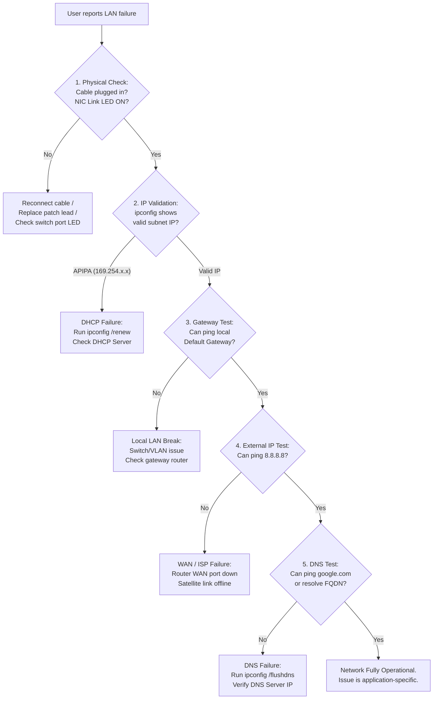

# Practical Task: Local Area Network (LAN) Troubleshooting Methodology

## 1. Objective
Apply a structured, step-by-step diagnostic workflow to isolate and resolve enterprise and departmental LAN connectivity failures.

## 2. Requirements
- Client PC connected to a network switch
- Diagnostic tools (`ping`, `tracert`, `arp`, `ipconfig`)

## 3. Background
LAN issues manifest as "No internet", inability to open shared files, or dropped connections. Guesswork wastes time. A standardized diagnostic tree resolves 99% of LAN incidents systematically.

---

## 4. Structured LAN Troubleshooting Flowchart



---

## 5. Step-by-Step Diagnostic Execution

### Step 1: Physical Layer Check
Inspect the RJ45 Ethernet jack on the PC and switch port.
- Green/Amber LED solid: Physical link established.
- LED dark / unlit: Physical link broken (damaged cable, disconnected patch panel, disabled switch port).

### Step 2: Validate IP Configuration
Run `ipconfig`. Ensure the address belongs to the departmental subnet (e.g., `192.168.100.x`).

### Step 3: Ping the Default Gateway
```cmd
ping 192.168.100.1
```
- Success: Local switch, cabling, and router interface are functional.
- Failure: Problem is localized between PC and local router.

### Step 4: Ping Public Internet IP
```cmd
ping 8.8.8.8
```
- Success: Wide Area Network routing and NAT are fully operational.
- Failure: Local LAN is fine, but WAN/ISP/Satellite connection is down.

### Step 5: Test DNS Name Resolution
```cmd
nslookup google.com
```
- Success: End-to-end network stack is 100% healthy.
- Failure: DNS server failure.

## 6. Expected Result
The technician isolates the exact failure point in under 2 minutes using standard diagnostic steps.

## 7. Troubleshooting Matrix
| Failed Test | Layer | Primary Action |
|---|---|---|
| Link LED unlit | Layer 1 Physical | Swap cable, test alternate wall jack |
| APIPA (169.254.x.x) | Layer 2/3 DHCP | `ipconfig /renew`, check DHCP scope |
| Cannot ping gateway | Layer 3 LAN | Check switch port VLAN, gateway IP |
| Cannot ping 8.8.8.8 | Layer 3 WAN | Check modem / VSAT satellite link |
| Cannot ping domain | Layer 7 DNS | `ipconfig /flushdns`, check DNS server |

## 8. Screenshots / Evidence
- `screenshots/05-lan-ping-sequence.png` — *Pending lab execution: Capture consecutive gateway, internet, and DNS ping tests.*

## 9. Practical Learning Outcome
Ability to systematically diagnose network failures without unnecessary hardware swaps or reboots.

## 10. Completion Status
Documented
