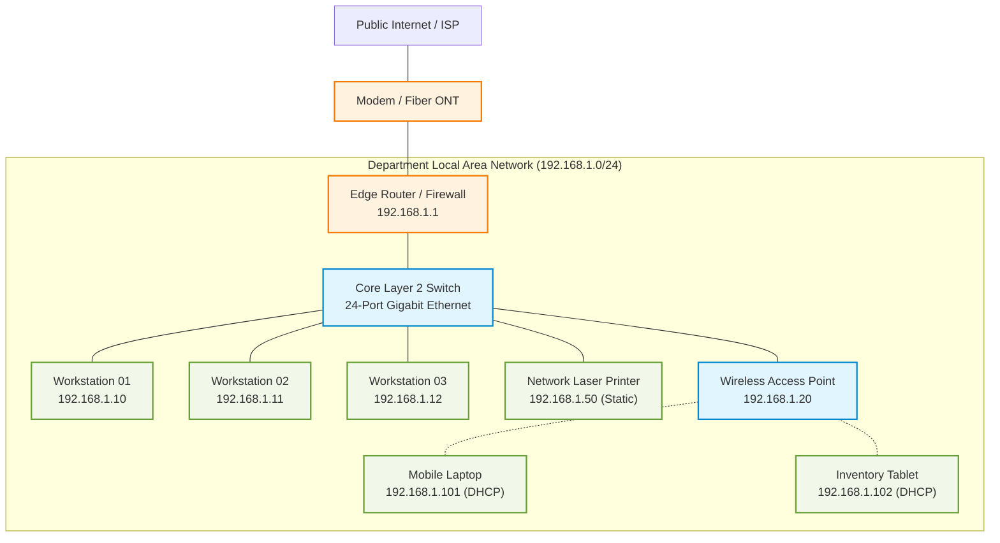

# Diagram: Basic Local Area Network (LAN) Topology

## 1. Overview
This diagram illustrates a standard small office / departmental LAN connecting client workstations, an enterprise network printer, and a wireless access point to a Layer 2 switch with upstream gateway routing.

## 2. Mermaid LAN Diagram

## 3. Addressing Scheme Summary

| Node | Interface | IPv4 Address | Assignment | Purpose |
|---|---|---|---|---|
| Router | LAN Interface | `192.168.1.1` | Static | Default Gateway & DHCP |
| Switch | Management IP | `192.168.1.2` | Static | Switch Management |
| NetPrinter | Ethernet | `192.168.1.50` | Static / Reservation | Shared Office Printing |
| AP | Ethernet | `192.168.1.20` | Static | Wi-Fi Access Point |
| Workstations | Ethernet | `192.168.1.10 - .49` | DHCP / Static | Office Workstations |
| Mobile Wi-Fi | WLAN | `192.168.1.100 - .254` | Dynamic DHCP | User Laptops / Tablets |
