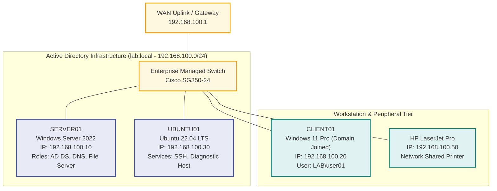

# Diagram: Enterprise Server-Client Network Topology with Active Directory

## 1. Overview
This topology illustrates the complete lab architecture utilized throughout this portfolio: a Windows Server 2022 Domain Controller (`SERVER01`) providing directory services, DNS, DHCP, and SMB file sharing to Windows 11 clients (`CLIENT01`) and Ubuntu Linux administration servers (`UBUNTU01`).

## 2. Mermaid Network Topology

## 3. Communication Protocols Illustrated
- **Authentication:** `CLIENT01` authenticates domain logins against `SERVER01` over Kerberos (Port 88) and LDAP (Port 389).
- **Name Resolution:** All workstations query `SERVER01` DNS on Port 53.
- **File Sharing:** Mapped drives access `\\SERVER01\Shares` over SMB on Port 445.
- **Printing:** Print jobs route to IP `192.168.100.50` over Standard TCP/IP Port 9100 (RAW).
- **Remote Shell:** Technicians administer `UBUNTU01` over SSH Port 22.
