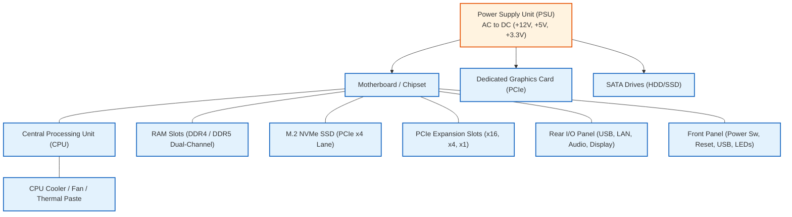

# Practical Task: Computer Hardware Architecture and Component Identification

## 1. Objective
Identify, inspect, and document every core internal desktop and server hardware component, motherboard interface, and expansion bus with strict adherence to ESD safety protocols.

## 2. Requirements
- Desktop PC chassis or server tower (opened for inspection)
- Electrostatic Discharge (ESD) wrist strap and grounding mat
- Phillips #1 and #2 screwdrivers

## 3. Background
Professional IT support technicians must recognize physical components instantly and understand their interdependencies:
1. **CPU (Central Processing Unit):** Compute engine executing machine instructions.
2. **Motherboard:** Printed circuit board interconnecting components via chipset buses.
3. **RAM (Random Access Memory):** Volatile high-speed temporary storage for active programs.
4. **Storage (SSD / HDD):** Non-volatile data storage (NVMe M.2, SATA SSD, mechanical HDD).
5. **Power Supply Unit (PSU):** Converts AC mains electricity to regulated low-voltage DC (+12V, +5V, +3.3V).
6. **GPU (Graphics Processing Unit):** Dedicated acceleration for video and display output.
7. **Cooling System:** Heatsinks, thermal paste, case fans, and liquid loops preventing thermal throttling.

---

## 4. Hardware System Architecture Diagram

---

## 5. Component Identification Procedure
1. **Safety Protocol:** Power off PC, disconnect AC power cable, press power button for 10 seconds to drain motherboard capacitors, and attach ESD wrist strap to unpainted metal chassis.
2. **Examine Motherboard:** Identify CPU socket (LGA or PGA), DIMM RAM slots, PCIe x16 slot, M.2 slots, SATA ports, and 24-pin ATX power connector.
3. **Examine CPU Cooling:** Inspect CPU heatsink and fan assembly. Check for dust clogging.
4. **Examine Storage:** Differentiate M.2 NVMe drive mounted directly on motherboard from 2.5" SATA SSD mounted in drive cage.
5. **Examine Power Supply:** Read PSU rating label. Note total wattage (e.g., 500W) and 80 Plus efficiency certification (Bronze, Gold, Platinum).

## 6. Expected Result
The technician identifies every internal component, describes its bus connection, and safely navigates the chassis interior without ESD damage.

## 7. Safety Precautions
- **NEVER** open the internal casing of a Power Supply Unit (PSU). Internal capacitors retain lethal voltage charges for hours after being unplugged!
- **NEVER** touch gold contact pins on CPUs or RAM sticks with bare fingers.

## 8. Screenshots / Evidence
- `screenshots/01-opened-chassis-labeled.png` — *Pending lab execution: Capture chassis interior with labeled components.*

## 9. Practical Learning Outcome
Comprehensive physical literacy with enterprise desktop and server components, form factors, and safety protocols.

## 10. Completion Status
Documented
