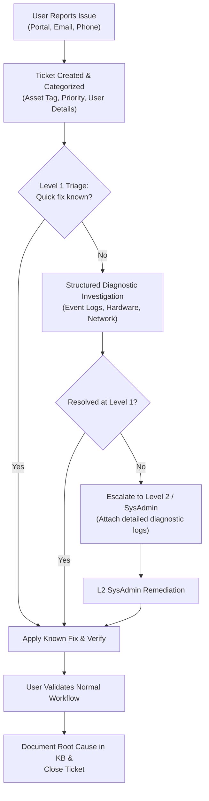

# Practical Task: IT Helpdesk Ticket Management Lifecycle and SLAs

## 1. Objective
Establish standard enterprise and maritime IT ticketing workflows, define Service Level Agreements (SLAs), prioritize incidents based on impact and urgency, and document complete ticket resolutions.

## 2. Requirements
- Ticketing system or ticketing log spreadsheet
- ITIL v4 Incident Management framework

## 3. Background
In IT Operations, an **Incident** is an unplanned interruption to or reduction in the quality of an IT service. A **Service Request** is a formal request from a user for something to be provided (e.g., software installation, password reset, new hardware).

### ITIL Incident Priority Matrix:
Priority is calculated as: **Priority = Impact × Urgency**
- **Impact:** Measure of the business/operational loss or number of affected users/systems.
- **Urgency:** Speed with which the issue requires resolution (e.g., safety or financial impact).

| Priority Level | Severity | Definition & Examples | Response SLA | Resolution SLA |
|---|---|---|---|---|
| **P1 - Critical** | Catastrophic | Core server down, ship-wide network outage, bridge navigation terminal failure | <= 15 minutes | <= 2 hours |
| **P2 - High** | Major | Department switch offline, finance payroll processing blocked, manager PC dead | <= 30 minutes | <= 4 hours |
| **P3 - Medium** | Moderate | Single user unable to print, individual email sync failure, localized slow Wi-Fi | <= 2 hours | <= 8 hours |
| **P4 - Low** | Minor | Request for new mouse, general how-to inquiry, scheduled software install | <= 4 hours | <= 24 hours |

---

## 4. End-to-End Ticket Lifecycle Workflow



---

## 5. Realistic Ticket Examples

### Sample Ticket 1: P2 High Priority (Department Impact)
```text
Ticket ID:        INC-2024-0104
Date & Time:      2024-11-08 09:15 UTC
Reported By:      Finance Manager (Accounts Dept)
Affected Asset:   ASSET-003 (Dell Latitude 5520)
Category:         Software / Outlook / Business Critical
Priority:         P2 - High
Summary:          Outlook crashes immediately upon launch with MAPI error during month-end payroll
Diagnostic Steps:
  1. Tested Outlook in Safe Mode (outlook.exe /safe) - launched successfully (rules out account lockout).
  2. Identified third-party PDF add-in causing runtime fault in Event Viewer (Application Log, Event ID 1000).
  3. Disabled conflicting COM add-in via File > Options > Add-ins.
Resolution:       Outlook launched normally; user verified sending payment ledger without error.
Status:           Resolved & Closed
Total Duration:   35 minutes
```

### Sample Ticket 2: P1 Critical Priority (Infrastructure Impact)
```text
Ticket ID:        INC-2024-0105
Date & Time:      2024-11-08 14:00 UTC
Reported By:      Multiple Departments (Bridge, Hotel Ops, HR)
Affected Asset:   SERVER01 (Windows Server 2022 Domain Controller)
Category:         Infrastructure / Active Directory / Network
Priority:         P1 - Critical
Summary:          Ship-wide domain authentication failure; users cannot access shared folders or log in
Diagnostic Steps:
  1. Connected to physical server console in IT Server Room.
  2. Discovered Active Directory Domain Services (NTDS) stopped due to drive C: reaching 100% capacity.
  3. Identified runaway IIS diagnostic log dump in C:\inetpub\logs.
  4. Purged obsolete logs; reclaimed 45 GB free space; restarted NTDS service.
Resolution:       Active Directory authenticated users immediately; verified replication with dcdiag.
Status:           Resolved & Closed
Total Duration:   28 minutes
```

## 6. Expected Result
The technician handles helpdesk tickets with professional communication, adheres to SLA milestones, and records comprehensive audit trails.

## 7. Completion Status
Documented
