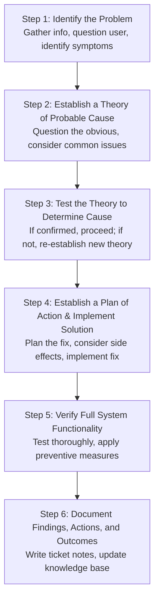

# Practical Task: CompTIA 6-Step Troubleshooting Methodology

## 1. Objective
Apply the industry-standard CompTIA 6-step troubleshooting methodology to systematically isolate and resolve complex desktop, server, and network issues.

## 2. Requirements
- IT Support problem scenario
- Standard troubleshooting log

## 3. Background
Amateur technicians jump to conclusions, swap random parts, change multiple software settings simultaneously, and cause new problems. Professional technicians apply the **CompTIA 6-Step Method**:

---

## 4. The 6 Steps Explained

### Detailed Breakdown:
1. **Identify the Problem:**
   - Gather information from the user: What were you doing when it failed? What is the exact error message? Has anything changed recently?
   - Duplicate the problem if possible.
   - Determine if anything changed (updates, physical movement, new software).
2. **Establish a Theory of Probable Cause:**
   - Question the obvious (Is the power cable loose? Is the Wi-Fi switch off?).
   - Brainstorm top 3 candidate causes from least to most complex.
3. **Test the Theory:**
   - Perform quick, non-destructive tests (e.g., ping gateway, test port).
   - If theory is disproven: Establish a new theory or escalate.
4. **Plan of Action & Implementation:**
   - Plan the fix before touching anything.
   - Ensure a rollback path exists (backup files or restore points).
   - Change **ONE THING AT A TIME**. Never change three settings simultaneously.
5. **Verify Full System Functionality:**
   - Have the end-user perform their actual daily workflow in front of you.
   - Implement preventive measures to prevent recurrence.
6. **Document Findings:**
   - Write clear closure notes in the ticketing system.
   - Update standard operating procedures (SOPs).

## 5. Expected Result
Problems are resolved efficiently with zero wasted effort, zero unintended collateral damage, and complete knowledge retention.

## 6. Completion Status
Documented
