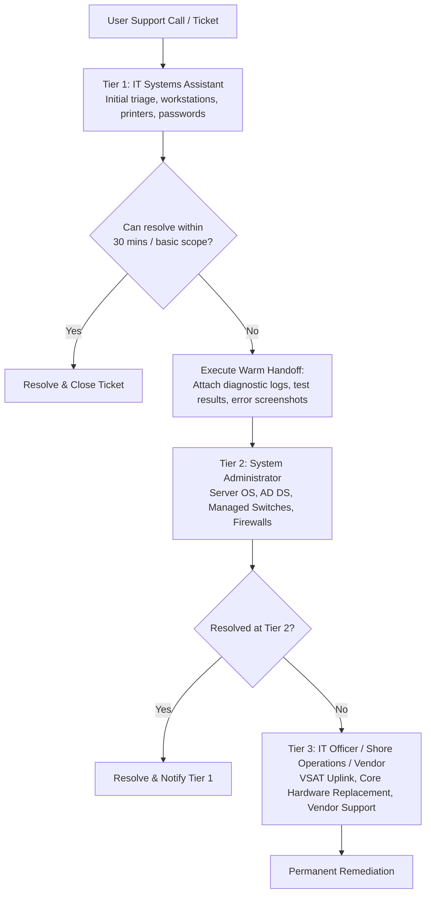

# Practical Task: IT Support Escalation Procedures and Tiers

## 1. Objective
Define IT support operational tiers (Tier 1 Helpdesk, Tier 2 Desktop/SysAdmin, Tier 3 Senior Infrastructure/Vendor), establish criteria for escalation, and document warm handoffs.

## 2. Requirements
- Service desk escalation policy
- Communication templates

## 3. Background
No single technician knows everything. Knowing **WHEN** and **HOW** to escalate is as important as knowing how to troubleshoot. In maritime environments, the hierarchy typically consists of:
- **Tier 1 (IT Systems Assistant / Helpdesk):** User onboarding, password resets, desktop hardware, printer maintenance, basic LAN troubleshooting.
- **Tier 2 (IT Systems Specialist / SysAdmin):** Server administration, Active Directory schema, managed switch VLANs, firewall routing, Exchange/M365 administration.
- **Tier 3 / Fleet Management (IT Officer / Shore-side Operations):** Core satellite VSAT uplinks, navigation system interfaces, vendor warranty dispatches, maritime cyber regulations (IMO 2021 compliance).

---

## 4. Escalation Workflow Diagram

---

## 5. Escalation Rules: When Must You Escalate?
1. **SLA Breach Threshold:** When 50% of the SLA resolution window has elapsed without identifying a verified cause.
2. **Access Limitation:** When resolution requires Domain Admin credentials, core firewall modifications, or physical access to sealed navigation equipment.
3. **Safety & Compliance:** Any anomaly touching Bridge Navigation, Maritime Safety, or Engine Automation systems requires immediate escalation to the IT Officer and Chief Engineer.
4. **Hardware Failure Under Warranty:** When components require vendor RMA dispatch.

## 6. Expected Result
Seamless collaboration between support tiers with zero dropped tickets, clear accountability, and rapid customer resolution.

## 7. Completion Status
Documented
