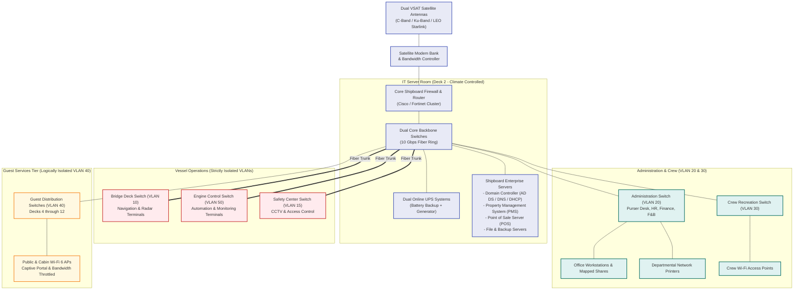

# Diagram: Simulated Cruise Ship IT Network Architecture

## 1. Overview
This diagram depicts a realistic, high-level maritime network topology showing physical locations, satellite uplinks, core server room components, and strict VLAN network segmentation.

> **Disclaimer:** This diagram is a hypothetical simulation designed for educational demonstration. Actual vessel systems adhere to proprietary safety and classification society (DNV/Lloyd's Register) standards.

---

## 2. Mermaid Simulated Shipboard Topology

---

## 3. Key Maritime Network Segmentation Concepts
1. **Logical Isolation:** Guest traffic (VLAN 40) is strictly firewalled from Administration (VLAN 20) and Navigation Operations (VLAN 10). Guests cannot reach internal servers under any circumstances.
2. **Quality of Service (QoS):** Satellite bandwidth is dynamically allocated. Bridge safety communications and financial PMS credit card clearing have priority #1. Guest streaming is throttled during satellite bandwidth congestion at sea.
3. **High Availability:** Core switches utilize redundant fiber uplinks and dual power supplies connected to isolated UPS phases backed by the ship's emergency diesel generator.
