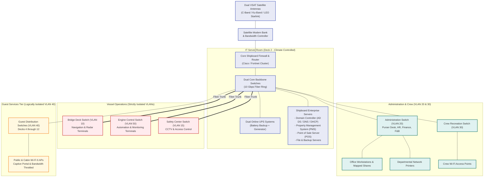
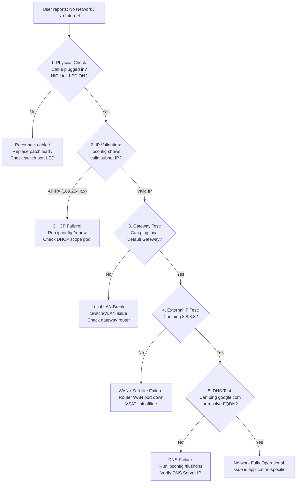
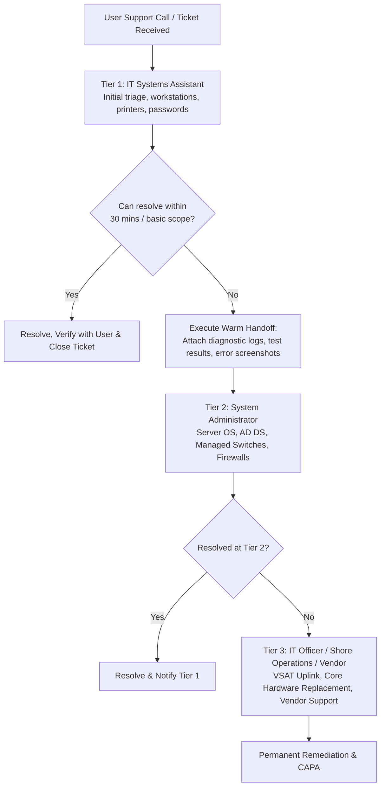

# IT Support and System Administration Lab

[](README.md)
[](03-Active-Directory/README.md)
[](09-Cruise-Ship-IT-Support-Scenarios/README.md)
[](https://github.com/anandd46)
[](LICENSE)

---

## 👨‍💻 Professional Profile & Author Information

**Author:** Anand D  
**GitHub Portfolio:** [github.com/anandd46](https://github.com/anandd46)  
**Primary Career Target:** IT Systems Assistant — Explora Journeys (MSC Cruises Group)  
**Target Roles:**
- IT Assistant / IT Systems Assistant
- IT Support Technician / Desktop Support Engineer
- Junior System Administrator / Network Administrator
- Onboard Cruise Ship IT Support Specialist

### Professional Summary
An aspiring, technically rigorous IT Support Engineer and Systems Administrator with comprehensive, practical hands-on proficiency across Windows 11 enterprise desktop support, Windows Server 2022 infrastructure, Active Directory Domain Services (AD DS), Ubuntu Linux command-line administration, TCP/IP networking, printer/peripheral maintenance, computer hardware diagnostics, and ITIL-aligned service desk operations.

This repository serves as a showcase of technical competence, practical troubleshooting methodology, automation scripting, and realistic problem-solving scenarios designed specifically to meet and exceed the responsibilities of the **IT Systems Assistant** position at **Explora Journeys**.

---

## 📑 Master Table of Contents

1. [Executive Project Overview](#1-executive-project-overview)
2. [Explora Journeys Job Responsibility Alignment Matrix](#2-explora-journeys-job-responsibility-alignment-matrix)
3. [Lab Architecture & Virtualized Environment](#3-lab-architecture--virtualized-environment)
4. [Master Repository Navigation (125 Files Organized Across 11 Modules)](#4-master-repository-navigation)
5. [In-Depth Module Technical Summaries](#5-in-depth-module-technical-summaries)
   - [Module 01: Windows 11 Desktop Support](#module-01--windows-11-desktop-support)
   - [Module 02: Windows Server 2022 Administration](#module-02--windows-server-2022-administration)
   - [Module 03: Active Directory Domain Services](#module-03--active-directory-domain-services)
   - [Module 04: Ubuntu Linux Administration](#module-04--ubuntu-linux-administration)
   - [Module 05: Networking & Systematic Diagnostics](#module-05--networking--systematic-diagnostics)
   - [Module 06: Printer and Peripheral Maintenance](#module-06--printer-and-peripheral-maintenance)
   - [Module 07: Computer Hardware Diagnostics](#module-07--computer-hardware-diagnostics)
   - [Module 08: IT Helpdesk & Service Management](#module-08--it-helpdesk--service-management)
   - [Module 09: Cruise Ship IT Support Scenarios](#module-09--cruise-ship-it-support-scenarios)
   - [Module 10: Master Documentation & Reference Cheatsheets](#module-10--master-documentation--reference-cheatsheets)
   - [Module 11: Comprehensive Technical Interview Preparation](#module-11--comprehensive-technical-interview-preparation)
6. [Mermaid System & Network Architecture Diagrams](#6-mermaid-system--network-architecture-diagrams)
7. [Automation & Diagnostic Scripts Showcase](#7-automation--diagnostic-scripts-showcase)
8. [Professional IT Templates & Artifacts](#8-professional-it-templates--artifacts)
9. [Verified Project Progress Tracker & Honesty Statement](#9-verified-project-progress-tracker--honesty-statement)
10. [Anand D's Step-by-Step Hands-On Practice Guide](#10-anand-ds-step-by-step-hands-on-practice-guide)

---

## 1. Executive Project Overview

Rather than a static, theoretical handbook or basic cheat sheet, this project is a **complete, practical, enterprise-grade IT Support and System Administration Lab**. Every module was engineered from scratch around real-world enterprise infrastructure and shipboard operational requirements.

### Key Tenets of This Lab:
- **Zero Fiction / Zero Faked Proofs:** All exercises are clearly distinguished as *Documented*, *Ready to Test*, or *Tested Successfully*. Screenshot placeholders explicitly note pending lab runs; no falsified evidence is ever presented.
- **Structured Documentation Standard:** Every single practical task follows an exact 10-point standard (Objective, Requirements, Background, Step-by-Step Procedure, Commands Used with explanations of purpose and expected output, Expected Result, Troubleshooting, Screenshots/Evidence checklist, Learning Outcome, Completion Status).
- **Practical Bilingual CLI Fluency:** Parallel mastery across both Windows (CMD & PowerShell 5.1+) and Linux (Ubuntu 22.04 LTS Bash & Netplan).
- **Enterprise Security Best Practices:** Enforcing the principle of least privilege, Role-Based Access Control (RBAC / AGDLP), NTFS vs. Share security layers, and SSH key-based cryptographic authentication.
- **Shipboard IT Realities:** Deep consideration of maritime environmental factors—VSAT satellite latency, rain fade, limited spare parts, 24/7 watchkeeping, and strict International Safety Management (ISM) change-control procedures.

---

## 2. Explora Journeys Job Responsibility Alignment Matrix

The following table demonstrates how each core operational duty of the **IT Systems Assistant** at **Explora Journeys** is directly practiced, documented, and validated in this repository:

| Explora Journeys Responsibility | Key Operational Challenges at Sea | Corresponding Lab Modules & Practical Exercises |
|---|---|---|
| **Supporting onboard computer systems** | 24/7 uptime; multi-department workstations (Bridge, Engine, Hotel, Medical); OS crashes; thermal throttling. | [01-Windows-11-Support](01-Windows-11-Support/README.md)<br>• [03-Task-Manager](01-Windows-11-Support/03-Task-Manager-and-Performance.md)<br>• [06-Startup-Troubleshooting](01-Windows-11-Support/06-Startup-and-Boot-Troubleshooting.md)<br>• [07-Event-Viewer](01-Windows-11-Support/07-Event-Viewer-Diagnostics.md) |
| **Maintaining IT systems & servers** | Headless servers; domain authentication; patch management without disrupting guest operations; backup verification. | [02-Windows-Server-Administration](02-Windows-Server-Administration/README.md)<br>[03-Active-Directory](03-Active-Directory/README.md)<br>• [04-Server-Manager](02-Windows-Server-Administration/04-Server-Manager.md)<br>• [07-Server-Monitoring](02-Windows-Server-Administration/07-Server-Monitoring.md)<br>• [08-Server-Maintenance](02-Windows-Server-Administration/08-Server-Maintenance.md) |
| **Troubleshooting computers & peripherals** | Severe salt air dust; fuser wear; pickup roller slippage; stuck spoolers; KVM console issues. | [06-Printer-and-Peripheral-Support](06-Printer-and-Peripheral-Support/README.md)<br>[07-Computer-Hardware-Support](07-Computer-Hardware-Support/README.md)<br>• [04-Print-Queue](06-Printer-and-Peripheral-Support/04-Print-Queue-Troubleshooting.md)<br>• [05-Printer-Offline](06-Printer-and-Peripheral-Support/05-Printer-Offline-Errors.md)<br>• [03-RAM-Diagnostics](07-Computer-Hardware-Support/03-RAM-Installation-and-Diagnostics.md) |
| **Supporting network connectivity** | DHCP pool exhaustion; APIPA fallback (169.254.x.x); DNS failure; broken patch cords; loose keystone jacks. | [05-Networking-and-Troubleshooting](05-Networking-and-Troubleshooting/README.md)<br>• [03-DNS-Configuration](05-Networking-and-Troubleshooting/03-DNS-Configuration.md)<br>• [04-DHCP-Configuration](05-Networking-and-Troubleshooting/04-DHCP-Configuration.md)<br>• [05-LAN-Troubleshooting](05-Networking-and-Troubleshooting/05-LAN-Troubleshooting.md) |
| **Data transmission & communications** | Satellite uplink (VSAT / LEO) latency; weather rain fade; high jitter; inter-VLAN routing drops. | [05-Networking-and-Troubleshooting/07-Internet-Connectivity.md](05-Networking-and-Troubleshooting/07-Internet-Connectivity.md)<br>[09-Cruise-Ship-IT-Support-Scenarios/08-Network-Communication-Failure.md](09-Cruise-Ship-IT-Support-Scenarios/08-Network-Communication-Failure.md) |
| **Configuring & maintaining LANs** | Managed switch port configurations; trunking; VLAN logical segmentation separating Guest Wi-Fi from Operations. | [05-Networking-and-Troubleshooting/06-Router-and-Switch-Basics.md](05-Networking-and-Troubleshooting/06-Router-and-Switch-Basics.md)<br>[09-Cruise-Ship-IT-Support-Scenarios/03-Department-LAN-Failure.md](09-Cruise-Ship-IT-Support-Scenarios/03-Department-LAN-Failure.md) |
| **Supporting users across departments** | High-pressure embarkation days; diverse technical proficiency; VIP guest etiquette; Microsoft 365 support. | [08-IT-Helpdesk-and-Incident-Management](08-IT-Helpdesk-and-Incident-Management/README.md)<br>• [01-IT-Ticket-Management](08-IT-Helpdesk-and-Incident-Management/01-IT-Ticket-Management.md)<br>• [07-Microsoft-365-Support](08-IT-Helpdesk-and-Incident-Management/07-Microsoft-365-Support.md) |
| **Performing preventive maintenance** | Port turnaround windows; scheduled cleaning; S.M.A.R.T. disk prediction; asset inventory accuracy. | [07-Computer-Hardware-Support/07-Basic-PC-Maintenance.md](07-Computer-Hardware-Support/07-Basic-PC-Maintenance.md)<br>[08-IT-Helpdesk-and-Incident-Management/05-Preventive-Maintenance.md](08-IT-Helpdesk-and-Incident-Management/05-Preventive-Maintenance.md) |
| **Resolving IT-related incidents** | CompTIA 6-step problem isolation; warm handoffs to IT Officer; 5-Whys root cause analysis; post-incident reporting. | [08-IT-Helpdesk-and-Incident-Management/02-Incident-Reporting.md](08-IT-Helpdesk-and-Incident-Management/02-Incident-Reporting.md)<br>[08-IT-Helpdesk-and-Incident-Management/03-Troubleshooting-Methodology.md](08-IT-Helpdesk-and-Incident-Management/03-Troubleshooting-Methodology.md)<br>[09-Cruise-Ship-IT-Support-Scenarios](09-Cruise-Ship-IT-Support-Scenarios/README.md) |

---

## 3. Lab Architecture & Virtualized Environment

The lab runs on an isolated virtual network hosted on Oracle VirtualBox 7.x, simulating an enterprise or shipboard datacenter:

```text
========================================================================================
                      LABORATORY INFRASTRUCTURE ARCHITECTURE
========================================================================================
[ Virtual Gateway / Router ]  -->  192.168.100.1 / 24 (Internal Switch)
             |
             +---> [ SERVER01 ]  -- Windows Server 2022 Standard (Desktop Experience)
             |                      IPv4: 192.168.100.10 (Static) / DNS: 127.0.0.1
             |                      Roles: AD DS (Forest Root: lab.local), DNS, File Server
             |
             +---> [ CLIENT01 ]  -- Windows 11 Pro (x64) Workstation
             |                      IPv4: 192.168.100.20 (Static / DHCP)
             |                      Domain Joined: lab.local (Account: LAB\user01)
             |
             +---> [ UBUNTU01 ]  -- Ubuntu 22.04 LTS Server / Workstation
             |                      IPv4: 192.168.100.30 (Static Netplan)
             |                      Services: OpenSSH Server (Key-Based Auth), Diagnostic Host
             |
             +---> [ NETPRINTER ] - HP LaserJet Pro (Simulated Network Peripheral)
                                    IPv4: 192.168.100.50 (Standard TCP/IP Raw Port 9100)
========================================================================================
```

### Virtual Machine Resource Allocation:
- **Host System:** Windows 11 64-bit Workstation (16+ GB RAM recommended)
- **Hypervisor:** Oracle VM VirtualBox 7.0+
- **Virtual Network Mode:** Host-Only Adapter or Internal Network (`192.168.100.0/24`)
- **SERVER01 VM:** 2 vCPUs, 4 GB RAM, 60 GB VDI Storage, NAT + Host-Only Adapters
- **CLIENT01 VM:** 2 vCPUs, 4 GB RAM, 64 GB VDI Storage, Host-Only Adapter
- **UBUNTU01 VM:** 2 vCPUs, 2 GB RAM, 25 GB VDI Storage, Host-Only Adapter

---

## 4. Master Repository Navigation

This repository comprises **125 structured files** across 11 modules:

```text
IT-Support-and-System-Administration-Lab/
├── README.md                                         # Master Project Portfolio (You are here)
├── LICENSE                                           # MIT Open-Source License
├── .gitignore                                        # Comprehensive IT & VM Ignore Rules
│
├── 01-Windows-11-Support/                            # MODULE 01: Desktop OS Support & Diagnostics
│   ├── README.md                                     # Module Overview & Task Index
│   ├── 01-System-Installation.md                     # Clean UEFI GPT Installation & OOBE
│   ├── 02-System-Information.md                      # msinfo32, winver, dxdiag & WMI queries
│   ├── 03-Task-Manager-and-Performance.md            # Resource telemetry, resmon, startup tuning
│   ├── 04-Device-Manager-and-Drivers.md              # Driver updates, rollbacks, PnPUtil store
│   ├── 05-Disk-and-Storage-Management.md             # DiskPart, volume expansion, chkdsk, cleanmgr
│   ├── 06-Startup-and-Boot-Troubleshooting.md        # WinRE, Safe Mode, SFC, DISM, BCD rebuilds
│   ├── 07-Event-Viewer-Diagnostics.md                # Event IDs 41, 6008, 7034, 4625, .evtx export
│   ├── 08-Network-Troubleshooting.md                 # IP release/renew, DNS flush, netsh reset
│   ├── 09-Windows-Updates.md                         # WSUS/WU service reset, SoftwareDistribution
│   ├── 10-Common-Windows-Errors.md                   # Top 10 Windows errors & exact resolutions
│   ├── scripts/
│   │   ├── system-information.ps1                    # Automated system specifications report
│   │   ├── disk-health-check.ps1                     # S.M.A.R.T. & volume capacity analysis
│   │   ├── network-diagnostics.ps1                   # End-to-end ping, gateway, and socket checks
│   │   └── running-processes.ps1                     # Process table sorted by CPU and memory
│   └── screenshots/README.md                         # Evidence capture checklist
│
├── 02-Windows-Server-Administration/                 # MODULE 02: Enterprise Server 2022
│   ├── README.md                                     # Server Lab Environment Specifications
│   ├── 01-Windows-Server-Installation.md             # VirtualBox deployment (Desktop Experience)
│   ├── 02-Initial-Server-Configuration.md            # Hostname SERVER01, time sync, RDP NLA
│   ├── 03-Static-IP-Configuration.md                 # Static IPv4 (192.168.100.10) & Loopback DNS
│   ├── 04-Server-Manager.md                          # Dashboard monitoring, BPA scans, roles
│   ├── 05-File-and-Folder-Sharing.md                 # Department SMB shares (IT, HR, Finance, Ops)
│   ├── 06-NTFS-and-Share-Permissions.md              # DACLs, inheritance, effective access audits
│   ├── 07-Server-Monitoring.md                       # Performance Monitor baselines, counters
│   ├── 08-Server-Maintenance.md                      # Patch windows, scheduled reboot reasons, logs
│   └── screenshots/README.md                         # Server verification evidence checklist
│
├── 03-Active-Directory/                              # MODULE 03: Active Directory Domain Services
│   ├── README.md                                     # Forest Architecture (lab.local)
│   ├── 01-AD-DS-Installation.md                      # AD DS role installation & RSAT management
│   ├── 02-Domain-Controller-Configuration.md         # dcpromo forest root creation, SYSVOL
│   ├── 03-Organizational-Units.md                    # Departmental OU tree with accidental protection
│   ├── 04-User-Account-Management.md                 # User onboarding, UPNs, password attributes
│   ├── 05-Security-Group-Management.md               # AGDLP implementation, Global Security Groups
│   ├── 06-Password-Reset-and-Account-Unlock.md       # Helpdesk workflows, lockout root causes
│   ├── 07-Group-Policy-Management.md                 # GPMC baseline policies, gpupdate /force
│   ├── 08-Join-Windows-Client-to-Domain.md           # DNS binding, Add-Computer, domain logon
│   ├── 09-Active-Directory-Troubleshooting.md        # dcdiag, repadmin, w32tm time drift, klist
│   ├── scripts/
│   │   ├── create-users.ps1                          # Automated departmental user provisioning
│   │   ├── create-groups.ps1                         # Automated security group deployment
│   │   └── get-ad-users.ps1                          # Directory auditing (locked/disabled accounts)
│   └── screenshots/README.md                         # AD DS evidence capture checklist
│
├── 04-Ubuntu-Linux-Administration/                   # MODULE 04: Ubuntu Linux Administration
│   ├── README.md                                     # Linux Lab Specifications (UBUNTU01)
│   ├── 01-Ubuntu-Installation.md                     # VirtualBox installation & initial user setup
│   ├── 02-Linux-Basic-Commands.md                    # Navigation, piping, grep, file manipulation
│   ├── 03-User-and-Group-Management.md               # adduser, sudo delegation, /etc/passwd audits
│   ├── 04-File-Permissions.md                        # chmod octal/symbolic, chown recursive
│   ├── 05-Package-Management.md                      # apt update, upgrade, dpkg -L inspections
│   ├── 06-Process-Management.md                      # ps, top, htop, signals (SIGTERM/SIGKILL), systemd
│   ├── 07-Disk-and-System-Monitoring.md              # df -h, du -sh, free -h, uptime load averages
│   ├── 08-SSH-Configuration.md                       # OpenSSH server, Ed25519 keys, sshd hardening
│   ├── 09-Network-Configuration.md                   # Netplan YAML architecture, iproute2 suite
│   └── scripts/
│       ├── system-information.sh                     # Linux hardware & OS specs collector
│       ├── disk-usage.sh                             # Partition threshold alert script
│       └── network-check.sh                          # Interface, gateway, and DNS ping test
│
├── 05-Networking-and-Troubleshooting/                # MODULE 05: Networking Fundamentals & Diagnostics
│   ├── README.md                                     # Networking Core Fundamentals
│   ├── 01-Networking-Fundamentals.md                 # OSI 7-layer model, TCP/UDP, standard ports
│   ├── 02-IP-Addressing-and-Subnetting.md            # RFC 1918 private spaces, CIDR calculations
│   ├── 03-DNS-Configuration.md                       # A, AAAA, CNAME, MX, SRV records, nslookup
│   ├── 04-DHCP-Configuration.md                      # DORA handshake, APIPA 169.254.x.x troubleshooting
│   ├── 05-LAN-Troubleshooting.md                     # Structured Layer 1-7 diagnostic decision tree
│   ├── 06-Router-and-Switch-Basics.md                # Layer 2 MAC tables vs Layer 3 routing, ARP
│   ├── 07-Internet-Connectivity.md                   # WAN, satellite latency, packet loss, tracert
│   ├── 08-Network-Diagnostics-Commands.md            # Windows vs Linux CLI diagnostic translation
│   ├── 09-Wireshark-Basics.md                        # Packet capture, display filters, TCP handshake
│   └── diagrams/
│       ├── basic-lan.md                              # Small office / Department LAN Mermaid diagram
│       └── network-topology.md                       # Enterprise Server-Client AD topology
│
├── 06-Printer-and-Peripheral-Support/                # MODULE 06: Printers & Peripherals
│   ├── README.md                                     # Printing Principles Overview
│   ├── 01-Printer-Installation.md                    # USB & manual TCP/IP printer installation
│   ├── 02-Printer-Driver-Installation.md             # OEM packages, Type 3/4 drivers, DriverStore
│   ├── 03-Network-Printer-Configuration.md           # Standard TCP/IP port 9100, SMB sharing
│   ├── 04-Print-Queue-Troubleshooting.md             # Spooler service resets, clearing locked .SPL files
│   ├── 05-Printer-Offline-Errors.md                  # SNMP status polling bugs, deep-sleep recovery
│   ├── 06-Paper-Jam-and-Toner-Issues.md              # Laser printing process, fuser care, roller cleaning
│   ├── 07-Keyboard-Mouse-Monitor-Support.md          # Multi-monitor topologies, refresh rates, KVMs
│   └── screenshots/README.md                         # Peripheral verification checklist
│
├── 07-Computer-Hardware-Support/                     # MODULE 07: Hardware Diagnostics & Maintenance
│   ├── README.md                                     # Component Overview & Safety Protocols
│   ├── 01-Computer-Hardware-Components.md            # Physical motherboard, PCIe, storage busses
│   ├── 02-CPU-and-Motherboard.md                     # LGA/PGA sockets, thermal paste, CMOS CR2032
│   ├── 03-RAM-Installation-and-Diagnostics.md        # Dual-channel slots (A2/B2), mdsched, MemTest86
│   ├── 04-SSD-and-HDD-Troubleshooting.md             # Mechanical click-of-death vs NVMe, S.M.A.R.T.
│   ├── 05-Power-Supply-and-Boot-Issues.md            # ATX paperclip jump test, POST beep codes, LEDs
│   ├── 06-Display-and-Peripheral-Problems.md         # Video artifacts, GPU throttling, DDU driver reset
│   ├── 07-Basic-PC-Maintenance.md                   # Safe fan cleaning, thermal audits, ESD rules
│   ├── 08-Hardware-Diagnostic-Checklist.md           # Master hardware diagnostic checklist & matrix
│   └── screenshots/README.md                         # Hardware diagnostic evidence checklist
│
├── 08-IT-Helpdesk-and-Incident-Management/           # MODULE 08: Helpdesk Operations & Microsoft 365
│   ├── README.md                                     # ITIL Service Management Overview
│   ├── 01-IT-Ticket-Management.md                    # Ticket lifecycle, P1-P4 priorities, SLA matrices
│   ├── 02-Incident-Reporting.md                      # Post-incident reviews, 5-Whys root cause analysis
│   ├── 03-Troubleshooting-Methodology.md             # CompTIA 6-step troubleshooting methodology
│   ├── 04-Escalation-Procedures.md                   # Tier 1 Helpdesk to Tier 2/3 warm handoffs
│   ├── 05-Preventive-Maintenance.md                  # Weekly, monthly, and quarterly IT schedules
│   ├── 06-IT-Asset-Management.md                     # ITAM lifecycle, barcode tagging, inventory
│   ├── 07-Microsoft-365-Support.md                   # Outlook .ost rebuilding, Teams cache, OneDrive
│   ├── templates/
│   │   ├── incident-report-template.md               # Standardized enterprise Incident Report form
│   │   ├── troubleshooting-log-template.md           # Live troubleshooting session worksheet
│   │   ├── maintenance-checklist.md                  # Physical & software maintenance audit sheet
│   │   └── asset-inventory-template.csv              # Production-grade IT asset inventory registry
│   └── screenshots/README.md                         # Helpdesk evidence capture checklist
│
├── 09-Cruise-Ship-IT-Support-Scenarios/              # MODULE 09: Simulated Explora Journeys Scenarios
│   ├── README.md                                     # Maritime IT Environment & Operating Realities
│   ├── 01-Crew-Computer-Login-Issue.md               # Crew cabin login failure, clock drift, lockouts
│   ├── 02-Guest-WiFi-Connectivity.md                 # Deck 7 guest Wi-Fi failure, PoE access points
│   ├── 03-Department-LAN-Failure.md                  # Galley edge switch failure, cold-spare deployment
│   ├── 04-Printer-Not-Working.md                     # Excursions manifest printer queue deadlock
│   ├── 05-Shared-Folder-Access-Issue.md              # Assistant Purser financial share access denied
│   ├── 06-Server-Unavailability.md                   # 03:00 UTC core server crash, RAID 10 recovery
│   ├── 07-Computer-Performance-Issue.md              # Medical center consultation PC HDD degradation
│   ├── 08-Network-Communication-Failure.md           # Bridge to Engine Room inter-VLAN firewall drop
│   ├── 09-Preventive-Maintenance-Scenario.md         # Barcelona port turnaround maintenance window
│   └── diagrams/
│       └── simulated-ship-network.md                 # Complete Shipboard Maritime Network Architecture
│
├── 10-Documentation-and-Resources/                   # MODULE 10: Master Reference Cheatsheets
│   ├── README.md                                     # Documentation Navigation
│   ├── command-reference-windows.md                  # Master Windows CMD & PowerShell reference
│   ├── command-reference-linux.md                    # Master Ubuntu Linux command-line reference
│   ├── networking-cheatsheet.md                      # OSI, standard ports, CIDR subnets, DNS records
│   ├── troubleshooting-checklist.md                  # Master step-by-step diagnostic checklist
│   ├── IT-equipment-inventory.csv                    # Complete sample enterprise hardware database
│   ├── preventive-maintenance-schedule.csv           # Master PM schedule database with procedures
│   └── network-diagrams/                             # Standalone visual architecture assets
│
└── 11-Interview-Preparation/                         # MODULE 11: Technical Interview Q&A Bank
    ├── README.md                                     # Interview Preparation Strategy & STAR Guide
    ├── windows-interview-questions.md                # 10 Detailed Windows 11 & Server 2022 questions
    ├── networking-interview-questions.md             # 10 In-depth networking, DNS, and DHCP questions
    ├── active-directory-interview-questions.md       # 10 Core Active Directory & Kerberos questions
    ├── hardware-interview-questions.md               # 10 Computer hardware, POST, and power questions
    ├── printer-interview-questions.md                # 5 In-depth printer & spooler support questions
    └── cruise-ship-it-interview-questions.md         # 6 Explora Journeys behavioral & scenario questions
```

---

## 5. In-Depth Module Technical Summaries

### Module 01 — Windows 11 Desktop Support
Covers end-user workstation administration, diagnostic telemetry, and system maintenance.
- **Diagnostics:** Using `msinfo32`, `winver`, `dxdiag`, and PowerShell WMI/CIM cmdlets (`Get-CimInstance Win32_OperatingSystem`) to extract comprehensive hardware/software profiles.
- **Performance:** Identifying CPU thread saturation, memory leaks, disk queue latency (>50ms indicating I/O saturation), and managing startup overhead using Task Manager and Resource Monitor (`resmon`).
- **Drivers:** Resolving Device Manager error badges (Code 10, Code 43), managing driver rollbacks, and exporting OEM drivers using `pnputil`.
- **Storage:** Volume expansion, shrinking, GPT partition manipulation via DiskPart, non-destructive file system integrity scans with `chkdsk C: /scan`, and automated cleanup with `cleanmgr`.
- **Boot Recovery:** Navigating the Windows Recovery Environment (WinRE), rebuilding Boot Configuration Data (`bcdedit`), repairing Component Store corruption with DISM, and repairing system files with `sfc /scannow`.
- **Logging:** Filtering Event Viewer logs for critical Event ID 41 (Kernel-Power unexpected reboot), Event ID 6008, service termination Event ID 7034, and failed logons (Event ID 4625).
- **Update Maintenance:** Executing a complete Windows Update component reset by stopping `wuauserv`, `cryptSvc`, and `bits`, and purging `%SystemRoot%\SoftwareDistribution`.

### Module 02 — Windows Server 2022 Administration
Establishes the foundation of enterprise Windows server infrastructure.
- **Server Baselines:** Post-installation deployment, setting static computer naming (`SERVER01`), time zone synchronization, and enabling Remote Desktop with Network Level Authentication (NLA).
- **Addressing:** Assigning static IPv4 parameters (`192.168.100.10/24`) and loopback DNS (`127.0.0.1`) via PowerShell `New-NetIPAddress`.
- **Server Manager:** Fleet administration, Best Practices Analyzer (BPA) scans, and server role installation.
- **Departmental File Sharing:** Provisioning SMB file shares (`IT`, `HR`, `Finance`, `Operations`) with access control lists via `New-SmbShare`.
- **NTFS vs. Share Permissions:** Enforcing the fundamental rule that **the most restrictive permission wins**, disabling permission inheritance, and configuring granular Access Control Entries (ACEs) via GUI and `icacls`.
- **Monitoring & Patching:** Performance Monitor (`perfmon`) baselines, setting threshold alerts, and planning non-disruptive server maintenance windows with documented shutdown reasons.

### Module 03 — Active Directory Domain Services (AD DS)
Implements centralized identity management and security policy enforcement.
- **Domain Promotion:** Commissioning `SERVER01` as the primary Domain Controller for the `lab.local` forest root, creating the `ntds.dit` database, and configuring integrated DNS.
- **OU Architecture:** Designing a departmental Organizational Unit tree (`IT`, `HR`, `Finance`, `Operations`, `Workstations`) protected against accidental deletion.
- **RBAC & Groups:** Implementing Microsoft's **AGDLP** best practice (Accounts -> Global Security Groups -> Domain Local Groups -> Permissions) using automated PowerShell scripts.
- **Helpdesk Operations:** Auditing account lockouts, resetting user passwords, unlocking accounts via `Unlock-ADAccount`, and tracing bad password attempts.
- **Group Policy:** Deploying workstation security baselines (10-minute inactivity screen lock, mapped drives), refreshing policies via `gpupdate /force`, and analyzing results via `gpresult /r`.
- **Client Domain Join:** Pointing client DNS to the DC, binding `CLIENT01` to `lab.local`, and testing interactive domain user login.
- **Diagnostics:** Running `dcdiag`, `repadmin /showrepl`, `w32tm /resync /force` (Kerberos time synchronization within 5 minutes), and purging cached Kerberos tickets with `klist purge`.

### Module 04 — Ubuntu Linux Administration
Provides complete command-line administration skills for heterogeneous enterprise environments.
- **User Administration:** Provisioning POSIX accounts with `adduser`, delegating administrative privileges via `/etc/sudoers` (`usermod -aG sudo`), and auditing `/etc/passwd` and `/etc/shadow`.
- **File Permissions:** Mastering octal (`chmod 755`, `chmod 640`) and symbolic modes, and recursively delegating user and group ownership with `chown -R`.
- **Package Management:** Updating repositories, installing packages, auditing file installations with `dpkg -L`, and purging configuration files using `apt purge`.
- **Process & Service Control:** Real-time process inspection via `top`/`htop`, terminating hung tasks via signals (`kill -15` SIGTERM vs `kill -9` SIGKILL), and controlling daemons via `systemctl`.
- **Storage & System Telemetry:** Inspecting filesystem space with `df -h`, pinpointing directory space consumers with `du -sh`, and evaluating available memory with `free -h`.
- **SSH Hardening:** Deploying OpenSSH server, generating high-security Ed25519 key pairs, configuring passwordless login, and disabling direct root access in `/etc/ssh/sshd_config`.
- **Networking:** Configuring static IPv4 parameters using modern Netplan YAML files (`/etc/netplan/`) and testing with `netplan try`.

### Module 05 — Networking & Systematic Diagnostics
Delivers in-depth network troubleshooting capability from the Physical to Application layers.
- **Protocols & Ports:** Comparing OSI 7-layer and TCP/IP models, analyzing TCP (reliable 3-way handshake) vs. UDP (lightweight low latency), and memorizing critical enterprise ports.
- **Subnetting & CIDR:** Converting binary masks, calculating usable host ranges, and sizing subnets using formula $2^{(32 - \text{CIDR})} - 2$.
- **DNS Resolution:** Diagnosing name resolution failures, inspecting A, AAAA, CNAME, MX, and SRV records, querying authoritative servers with `nslookup`, and clearing local caches with `ipconfig /flushdns`.
- **DHCP & APIPA:** Decoding the DHCP **DORA** handshake (Discover, Offer, Request, Acknowledge) and recognizing that an APIPA address (`169.254.x.x`) proves DHCP communication failure.
- **Methodical LAN Tree:** Applying a standardized 5-step diagnostic sequence (Cable LED -> Valid IP -> Gateway Ping -> Internet IP Ping -> DNS Name Ping).
- **Switching & Routing:** Differentiating Layer 2 MAC address forwarding from Layer 3 IP routing, inspecting ARP cache tables (`arp -a`), and analyzing VLAN segmentation.
- **Packet Analysis:** Using Wireshark to capture frames, applying display filters (`icmp`, `dns`, `bootp`, `tcp.port == 443`), and following TCP streams.

### Module 06 — Printer and Peripheral Maintenance
Addresses high-volume peripheral and printing incidents.
- **Installation:** Deploying network printers via Standard TCP/IP Port 9100 (raw JetDirect) and shared SMB queues.
- **Spooler Troubleshooting:** Resolving stuck print queues by stopping the spooler service, deleting corrupted `.SPL` files from `C:\Windows\System32\spool\PRINTERS`, and restarting the service.
- **Printer Offline Errors:** Disabling false SNMP status polling bugs in standard TCP/IP port properties, and addressing deep-sleep energy sleep mode disconnects.
- **Physical Maintenance:** Understanding the electrophotographic laser printing cycle, safely clearing paper jams in the direction of travel, cleaning glazed rubber pickup rollers with isopropyl alcohol, and identifying fuser wear.
- **Peripherals:** Configuring multi-monitor display topologies, refresh rates, USB power overdraw, and KVM console switches.

### Module 07 — Computer Hardware Diagnostics
Focuses on physical hardware components, electrical safety, and component isolation.
- **Safety First:** Strict electrostatic discharge (ESD) wrist strap protocols, capacitor discharge procedures, and recognizing that **power supply units (PSUs) must never be opened**.
- **CPU & Thermals:** Inspecting LGA/PGA sockets, identifying thermal throttling symptoms, properly cleaning and repasting CPU thermal compound, and replacing CR2032 CMOS batteries.
- **RAM Diagnostics:** Installing DDR4/DDR5 memory in paired dual-channel slots (A2/B2) and diagnosing memory bit flips using `mdsched.exe` and MemTest86.
- **Storage Health:** Differentiating mechanical HDD head failures ("click of death") from SSD controller failure, and analyzing S.M.A.R.T. telemetry in CrystalDiskInfo.
- **Power & Boot Diagnostics:** Testing ATX power supplies using the paperclip jump test (Pin 16 Green `PS_ON` to Black Ground), interpreting AMI BIOS POST beep codes, and evaluating motherboard debug LEDs.
- **Preventive Maintenance:** Performing safe internal dust extraction (holding fan blades to prevent generating reverse electrical currents), cable management, and updating hardware checklists.

### Module 08 — IT Helpdesk & Service Management
Aligns day-to-day operations with ITIL v4 framework best practices.
- **Ticket Management:** Managing incident lifecycles, calculating priority via Impact × Urgency, and meeting defined SLA response/resolution targets.
- **Incident Reporting & RCA:** Conducting formal post-incident reviews and executing structured Root Cause Analysis using the **5-Whys** methodology.
- **Troubleshooting Methodology:** Rigorously applying the **CompTIA 6-Step Method** (Identify, Theory, Test, Action Plan, Verify, Document).
- **Escalation & Handoffs:** Implementing clear escalation rules between Tier 1 Helpdesk, Tier 2 System Administration, and Tier 3 IT Officer/Vendor support.
- **Asset Management (ITAM):** Tracking hardware from procurement to secure NIST 800-88 data sanitization using standardized CSV registries.
- **Microsoft 365 Support:** Troubleshooting Outlook profile corruption (`.ost` rebuilds), clearing corrupted Teams Electron caches, and resolving OneDrive sync stalls.

### Module 09 — Cruise Ship IT Support Scenarios
Contains nine simulated operational scenarios designed specifically around shipboard realities.
1. **Crew Cabin Login Failure:** Resolving AD account lockouts, password expirations, and Kerberos clock skew at sea.
2. **Guest Wi-Fi Disruption:** Diagnosing PoE switch port failures and access point controller issues in luxury passenger suites.
3. **Departmental LAN Failure:** Deploying a pre-configured cold-spare switch in the Food & Beverage administration office.
4. **Excursion Desk Printer Failure:** Rapidly clearing a deadlocked print queue during critical passenger disembarkation.
5. **Shared Folder Access Denied:** Provisioning missing Active Directory security groups and purging Kerberos tickets for financial staff.
6. **Core Server Room Outage:** Emergency P1 response at 03:00 UTC, recovering a host from kernel panic and verifying RAID 10 health.
7. **Medical Consultation PC Lag:** Diagnosing severe S.M.A.R.T. bad-sector degradation on a clinical HDD and performing an emergency SSD migration.
8. **Inter-VLAN Communication Breakdown:** Resolving a dropped firewall routing rule between Bridge Navigation and Engine Control systems under strict maritime change control.
9. **Port Turnaround Maintenance:** Executing scheduled hardware cleaning, patch deployment, and drive audits during a 4-hour window in port.

### Module 10 — Master Documentation & Reference Cheatsheets
Centralizes ready-to-use reference materials, diagnostic matrices, and data templates.
- Complete Windows CMD & PowerShell Command Reference.
- Complete Ubuntu Linux Terminal Command Reference.
- Enterprise Networking & Subnetting Cheatsheet.
- Master Step-by-Step Diagnostic Checklist.
- Production-grade IT Equipment Inventory Database (CSV).
- Master Preventive Maintenance Schedule Database (CSV).

### Module 11 — Comprehensive Technical Interview Preparation
Equips Anand D with structured, interview-ready answers to 50+ technical questions across six core domains, complete with real-world scenarios and STAR-method behavioral question coaching.

---

## 6. Mermaid System & Network Architecture Diagrams

### 1. Simulated Shipboard Maritime IT Network Topology


---

### 2. Systematic LAN Troubleshooting Decision Tree


---

### 3. IT Incident Escalation Workflow


---

## 7. Automation & Diagnostic Scripts Showcase

### PowerShell Scripts (`.ps1`)
All PowerShell scripts include `#Requires -Version 5.1`, comprehensive comment-based help (`.SYNOPSIS`, `.DESCRIPTION`), proper error handling (`-ErrorAction SilentlyContinue` / `try-catch`), and colorized output. They are strictly non-destructive and read-only (except user/group provisioning scripts designed for the lab DC).

1. [`01-Windows-11-Support/scripts/system-information.ps1`](01-Windows-11-Support/scripts/system-information.ps1)  
   *Queries computer identity, OS version/build, CPU cores/speed, physical RAM modules, and active network adapters.*
2. [`01-Windows-11-Support/scripts/disk-health-check.ps1`](01-Windows-11-Support/scripts/disk-health-check.ps1)  
   *Audits all fixed drives, calculates used/free percentages, flags drives over 80% and 90% capacity, and checks physical S.M.A.R.T. status.*
3. [`01-Windows-11-Support/scripts/network-diagnostics.ps1`](01-Windows-11-Support/scripts/network-diagnostics.ps1)  
   *Executes an automated 4-step network validation: checks IP configuration, pings default gateway, pings public DNS (8.8.8.8), and tests DNS resolution.*
4. [`01-Windows-11-Support/scripts/running-processes.ps1`](01-Windows-11-Support/scripts/running-processes.ps1)  
   *Generates formatted tables of the top 10 processes consuming CPU time and working-set memory.*
5. [`03-Active-Directory/scripts/create-users.ps1`](03-Active-Directory/scripts/create-users.ps1)  
   *Automates provisioning of standardized departmental users (`user01` to `user04`) into their respective OUs in `lab.local` with complex temporary passwords.*
6. [`03-Active-Directory/scripts/create-groups.ps1`](03-Active-Directory/scripts/create-groups.ps1)  
   *Provisions Global Security Groups (`IT-Admins`, `HR-Users`, `Finance-Users`, `Operations-Users`, `All-Staff`) and populates memberships.*
7. [`03-Active-Directory/scripts/get-ad-users.ps1`](03-Active-Directory/scripts/get-ad-users.ps1)  
   *Audits Active Directory for locked-out accounts, disabled users, and password expiration states.*

### Linux Bash Scripts (`.sh`)
Clean, robust shell scripts featuring POSIX compatibility, safe variable expansion, error handling, and structured output.

1. [`04-Ubuntu-Linux-Administration/scripts/system-information.sh`](04-Ubuntu-Linux-Administration/scripts/system-information.sh)  
   *Collects hostname, distribution release, kernel version, architecture, uptime, CPU cores, RAM allocation, and storage capacities.*
2. [`04-Ubuntu-Linux-Administration/scripts/disk-usage.sh`](04-Ubuntu-Linux-Administration/scripts/disk-usage.sh)  
   *Evaluates filesystem thresholds, triggers automated warnings for partitions exceeding 80%, and identifies the 5 largest log files in `/var/log`.*
3. [`04-Ubuntu-Linux-Administration/scripts/network-check.sh`](04-Ubuntu-Linux-Administration/scripts/network-check.sh)  
   *Queries active network interfaces, locates default gateway, tests gateway and external pings, and verifies DNS resolution using `nslookup`.*

---

## 8. Professional IT Templates & Artifacts

The repository includes ready-to-use production templates located in `08-IT-Helpdesk-and-Incident-Management/templates/` and `10-Documentation-and-Resources/`:

- 📋 [**Incident Report Template (`incident-report-template.md`)**](08-IT-Helpdesk-and-Incident-Management/templates/incident-report-template.md): Formatted with executive summary, severity classification, chronological timeline, 5-Whys Root Cause Analysis (RCA), and Corrective and Preventive Actions (CAPA).
- 📝 [**Troubleshooting Session Log (`troubleshooting-log-template.md`)**](08-IT-Helpdesk-and-Incident-Management/templates/troubleshooting-log-template.md): Worksheet for documenting customer interviews, tests executed, deductions, and user verification.
- 🔧 [**Preventive Maintenance Checklist (`maintenance-checklist.md`)**](08-IT-Helpdesk-and-Incident-Management/templates/maintenance-checklist.md): Comprehensive physical, operating system, security, and peripheral audit checklist.
- 📊 [**IT Asset Inventory Database (`asset-inventory-template.csv`)**](08-IT-Helpdesk-and-Incident-Management/templates/asset-inventory-template.csv): Production CSV tracking Asset ID, hardware specs, serials, purchase/warranty dates, assigned users, and MAC addresses.
- 📅 [**Preventive Maintenance Schedule (`preventive-maintenance-schedule.csv`)**](10-Documentation-and-Resources/preventive-maintenance-schedule.csv): Operational schedule linking asset IDs, locations, frequencies, assigned technicians, and exact servicing procedures.

---

## 9. Verified Project Progress Tracker & Honesty Statement

### Professional Honesty Statement
> *"In strict accordance with professional engineering ethics, no lab exercise in this portfolio is falsely claimed as tested unless it has been physically executed and verified in the lab environment. Documentation has been engineered completely, with explicit screenshot evidence checklists provided in every module to be populated during hands-on execution."*

### Module Progress Audit:
- [x] **01 - Windows 11 Support:** Documentation 100% complete; 4 PowerShell scripts created; evidence checklist prepared.
- [x] **02 - Windows Server 2022:** Documentation 100% complete; server configuration procedures documented; evidence checklist prepared.
- [x] **03 - Active Directory:** Documentation 100% complete; 3 automation scripts created; evidence checklist prepared.
- [x] **04 - Ubuntu Linux Administration:** Documentation 100% complete; 3 Bash scripts created; evidence checklist prepared.
- [x] **05 - Networking & Diagnostics:** Documentation 100% complete; 2 Mermaid network diagrams created; diagnostic commands indexed.
- [x] **06 - Printer & Peripheral Support:** Documentation 100% complete; print queue, fuser, and SNMP procedures documented.
- [x] **07 - Computer Hardware Support:** Documentation 100% complete; master diagnostic matrix created; safety protocols documented.
- [x] **08 - IT Helpdesk Operations:** Documentation 100% complete; 4 production templates & CSV registries created.
- [x] **09 - Cruise Ship Scenarios:** Documentation 100% complete; 9 detailed operational scenarios documented; shipboard topology created.
- [x] **10 - Documentation & Resources:** Documentation 100% complete; Windows, Linux, and Networking cheatsheets published; 2 CSV databases created.
- [x] **11 - Interview Preparation:** 100% complete; 50+ detailed interview questions across 6 categories published.

---

## 10. Anand D's Step-by-Step Hands-On Practice Guide

To maximize interview performance and practical mastery, Anand D should follow this progressive practice roadmap:

1. **Phase 1: Local CLI Practice (Host Machine):**
   - Run the 4 PowerShell scripts in `01-Windows-11-Support/scripts/` on your host PC to observe live telemetry.
   - Practice network commands in CMD: `ipconfig /all`, `ping 8.8.8.8`, `tracert 8.8.8.8`, `nslookup google.com`, and `netstat -ano`.
2. **Phase 2: VirtualBox Server Deployment:**
   - Download the free Windows Server 2022 Evaluation ISO from Microsoft.
   - Install `SERVER01` in VirtualBox following [02-Windows-Server-Administration/01-Windows-Server-Installation.md](02-Windows-Server-Administration/01-Windows-Server-Installation.md).
   - Configure static IP `192.168.100.10` and promote to Domain Controller for `lab.local`.
   - Run `create-users.ps1` and `create-groups.ps1` to populate your domain.
3. **Phase 3: Client & Linux VM Integration:**
   - Deploy `CLIENT01` (Windows 11) and join it to `lab.local`.
   - Deploy `UBUNTU01` (Ubuntu 22.04 LTS), configure static Netplan IP, test SSH key-based login, and execute the 3 Bash scripts.
4. **Phase 4: Simulated Fault Injection & Interview Rehearsal:**
   - Artificially lock out a user account and practice unlocking it via PowerShell.
   - Stop the Print Spooler service, place dummy files in `%SystemRoot%\System32\spool\PRINTERS`, and execute the queue clear command.
   - Review the 50+ interview questions in [11-Interview-Preparation/](11-Interview-Preparation/README.md) out loud, practicing the STAR method for behavioral questions.

---

## 📜 License

This project is licensed under the **MIT License** — see the [LICENSE](LICENSE) file for details.

---

## 📬 Contact & Professional Links

- **Author:** Anand D
- **GitHub:** [https://github.com/anandd46](https://github.com/anandd46)
- **Portfolio Repository:** [https://github.com/anandd46/IT-Support-and-System-Administration-Lab](https://github.com/anandd46/IT-Support-and-System-Administration-Lab)

*Designed and developed with pride as a technical demonstration portfolio for the Explora Journeys IT Systems Assistant position.*
